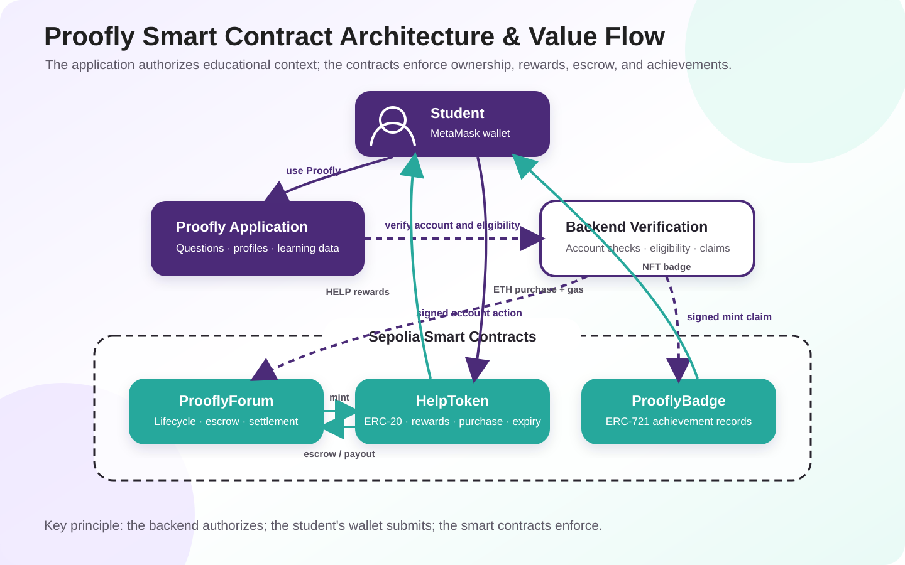

# Proofly: A Blockchain-Supported Peer-Learning Platform

## Project Report

**Project name:** Proofly  
**Course:** COMP7610 — Introduction to Web3 and Blockchain  
**Developer:** Bingting Huangfu  
**Contribution:** 100% completed by the author

**Project summary:** Proofly is a course-based peer-learning dApp that connects questions, explanations, HELP-token rewards, and NFT achievement badges. Its smart contracts make the reward lifecycle and badge ownership transparent and verifiable while the application preserves a readable, privacy-conscious learning experience.

---

## Executive Summary

Proofly is a peer-learning dApp built around the cycle **Ask → Explain → Recognize → Reward → Reflect and Progress**. It responds to two related problems: students may hesitate to ask for help, and classmates who provide thoughtful explanations often receive little lasting recognition.

The project's main technical focus is its smart-contract system. `ProoflyForum` governs questions, sponsored or escrowed bounties, answers, best-answer selection, expiry, and final settlement. `HelpToken` implements the HELP learning currency, including purchases, transfers, permanent rewards, and expiring answer rewards. `ProoflyBadge` creates authorized ERC-721 achievement records. Together, these contracts make the platform's incentives and achievements verifiable while keeping detailed educational content and private account information off-chain.

---

## 1. Background and Motivation

### 1.1 The peer-learning problem

Peer learning is valuable because another student can often explain a difficult idea in familiar language and from a similar point of view. However, informal peer support commonly faces four problems.

First, students may hesitate to ask for help. In learning cultures where admitting difficulty feels uncomfortable, a student may remain silent even when other students have the same question.

Second, helpful contributions are not clearly recognized. Writing a careful explanation requires time, patience, and subject knowledge, but the contributor may receive no lasting evidence that the effort mattered. Directly asking for compensation can also feel inappropriate in an educational community.

Third, after-class participation depends heavily on personal initiative. Conventional discussion boards provide a place to post, but often do not offer an engaging feedback loop. A question may be answered once and then disappear into an archive.

Finally, students may share a course without knowing one another's strengths. Without a visible history of contributions, it is difficult to identify which classmate understands smart-contract security, consensus, token economics, or another specific topic.

### 1.2 Why blockchain is relevant

Proofly does not use blockchain merely to reproduce a normal forum. It uses blockchain selectively where verifiability and ownership add value:

- HELP balances and transfers belong to wallet addresses rather than being editable database numbers.
- Question rewards can be held and settled according to transparent contract rules.
- Reward events and NFT ownership can be independently verified on a public testnet.
- Achievement badges become wallet-owned records rather than images that the application can arbitrarily assign.
- Signed claims connect application-level student eligibility to on-chain actions without publishing personal identity.

At the same time, storing full question text, explanations, charts, and student profiles on-chain would be expensive and unnecessarily public. Proofly therefore deliberately combines blockchain state with an off-chain application layer.

### 1.3 Project objective

The objective is to create a lower-pressure, course-based peer-learning environment that gives students a reason to ask, explain, improve, and return. The intended result is not simply more posts, but a healthier learning loop with:

- more after-class engagement;
- better preparation for class;
- stronger motivation to contribute;
- clearer recognition of subject expertise; and
- an understandable record of personal learning progress.

---

## 2. Core Idea and Learning Cycle

The product idea is summarized by the statement:

> **Questions become contributions. Contributions become achievements.**

Proofly organizes learning into five connected stages.

### 2.1 Ask

A student publishes a question inside a course and assigns one or more topics. The question includes a title, details, publication time, expiry information, status, and a HELP reward. To reduce the barrier for new users, Proofly sponsors the reward for the first three questions associated with each verified student account. Posting itself is not a fee; sponsorship means that the reward does not come from the student's own HELP balance.

### 2.2 Explain

Classmates submit explanations in their own words. A verified student account may submit only one answer to a particular question, even if the account has multiple wallet addresses. The answer may be edited before the question expires, but editing does not produce another reward. This prevents repeated submissions from farming HELP while still allowing a student to improve an explanation.

The initial answer submission earns 1 HELP. This particular participation reward expires after 90 days, encouraging continued use rather than indefinite accumulation. Transferring the reward to another address does not reset its expiry.

### 2.3 Recognize

The question publisher may select the explanation that helped most. The selected answer is displayed publicly beneath the question, providing immediate recognition before settlement. The publisher may change the selection while the question remains open. After expiry, the selection is locked.

This separation between **selection** and **settlement** is important. Selection communicates the current judgment of the asker; expiry creates a final deadline after which the contract can distribute the bounty deterministically.

### 2.4 Reward

When an expired question is finalized, its selected answerer receives the question bounty. If there is no selected answer, the question closes without a winner and an unused self-funded bounty remains in the platform reward pool. Every fifth best-answer achievement also produces a 10 HELP milestone reward.

Students may also purchase permanent HELP using Sepolia ETH at the demo contract rate of **1 ETH = 100 HELP**. Purchased HELP, bounty rewards, and milestone rewards do not expire. Only the 1 HELP answer-submission reward uses the 90-day expiry rule.

### 2.5 Reflect and progress

The My Reputation page transforms activity into learning feedback. Students can review questions they asked, explanations they submitted, selected best answers, topic strengths, activity history, trends by term and course, and progress toward the next milestone. This closes the loop: contribution is not only rewarded but becomes information that can guide future study.

---

## 3. Product and Interaction Design

### 3.1 Information architecture

The main interface is divided into three learning views and two account tools:

1. **Question Feed** — course questions, topics, explanations, rewards, statuses, and expiry.
2. **My Reputation** — personal contributions, learning impact, activities, trends, and milestones.
3. **Classmates** — course ranking, community activity, topic concentration, and public profiles.
4. **HELP Wallet** — wallet connection, address verification, token purchase and transfer, balances, trends, and history.
5. **NFT Badges** — minting guide, achievement catalog, mintable-badge filter, and owned-badge library.

The navigation keeps learning tasks separate from wallet operations. This prevents the application from feeling like a cryptocurrency dashboard first and an educational tool second.

### 3.2 Question Feed

Questions are scoped by course because a student may participate in several current or expired courses. Topic selection is searchable and supports multiple values. A topic created inside the new-question modal is added to the shared filter list only after the question is actually submitted; abandoning the modal does not pollute the topic catalog.

The feed supports filtering by status and topic and sorting by:

- publication time;
- latest explanation update; and
- number of explanations.

Each question card displays the question, details, publisher nickname, explanation count, topics, HELP reward, publication time, expiry information, and status. Long details can be collapsed while retaining a one-line preview. Relative time is shown in the card, while hovering reveals the exact date and time.

The status communicates the lifecycle visually:

- **Accepting answers** — the question is open;
- **Solved** — the question expired with a selected best answer; and
- **Closed** — the question expired without a selected answer.

For open questions, remaining time appears beside the publication information. Solved and closed questions no longer display a countdown. When a new question is published, a short append animation places it at the top of the feed, giving clear feedback that the submission succeeded.

### 3.3 Best-answer interaction

The best answer is placed at the bottom of the question card, after the ordinary question information and action controls. Only the publisher can change the selection. Activating **Change selection** opens a compact modal containing the available explanations, sorted by publication time in descending order. The current answer is excluded as a replacement choice. The underlined action style avoids giving a secondary operation too much visual weight.

### 3.4 My Reputation

The reputation page is designed as a learning dashboard rather than a single abstract score. It contains:

- the student's provider/profile summary;
- learning impact analysis;
- activity and the next milestone; and
- contribution history.

Filters allow performance to be viewed by term and course. A measure selector changes the analysis among explanations, best answers, and questions posted. Strongest areas are calculated from topics within the selected course. Where a performance score is displayed, its component measures and formula are made explicit rather than presenting an unexplained number.

Contribution history preserves context. Questions asked by the student show question details and the selected best answer when one exists. Questions answered by the student show the original question and details followed by the student's own explanation.

### 3.5 Classmates and community discovery

The Classmates page changes by course because different courses have different participants. An AG Grid table presents a ranking with horizontal separators and no vertical lines. Ranking priority is:

1. number of best answers;
2. answers shared; and
3. questions asked.

Students are represented by nicknames, not real names, email addresses, or wallet addresses. Clicking a nickname opens a Teams-style profile modal showing contribution metrics, strongest topic, selection rate, and currently owned badges.

The page also includes community-level analytics: new questions or explanations over time, selectable by day or week, and a topic comparison between questions and answers. These views help students discover where discussion is concentrated and where help may be missing.

### 3.6 Privacy and multi-address account design

One student may use several MetaMask addresses. Proofly lets the student switch MetaMask accounts and append addresses to one Proofly account by signing a one-time verification message. Each address can belong to only one student account, and a verified association is permanent in the demo design.

The account-level interface can aggregate HELP balances and known badges across verified addresses, but the blockchain assets remain owned by their individual addresses. HELP transfers use the currently connected address as the source, while the destination selector is restricted to other verified addresses belonging to the same student account. Gas is paid separately in ETH.

This design supports convenience without pretending that the website can secretly enumerate every address inside a MetaMask wallet. An address becomes part of the Proofly account only when the student explicitly switches to it and signs the verification challenge.

### 3.7 Achievement badges

Proofly includes six badge identities:

- Learning Pioneer;
- Best Explainer;
- Curious Mind;
- Consensus Guide;
- Security Scout; and
- Course Finisher.

Each badge has its own metadata JSON file and SVG artwork. The collection can be filtered between all achievements and those currently ready to mint. A mint button remains disabled until the requirement is met. Minting is achievement-based: the student pays only the network gas fee; the current contract does not charge HELP for badge minting.

---

## 4. System Architecture

Proofly uses a hybrid architecture consisting of a student-facing web application, a lightweight application service, and three Sepolia smart contracts. The application layer stores course content, profiles, analytics, verified account-to-wallet relationships, and badge progress. MetaMask lets the student sign verification messages and approve blockchain transactions. The contracts independently enforce HELP ownership, reward settlement, and NFT ownership.

The application service acts as a bridge between a private educational account and a public wallet. After checking the relevant account or achievement condition, it produces a short-lived EIP-712 authorization. The authorization does not execute a transaction or take control of the wallet; the student still confirms the on-chain action through MetaMask.

The on-chain/off-chain boundary is summarized below. This division of responsibility is intentional.

| Off-chain | On-chain |
|---|---|
| Question and explanation text | HELP balances and transfers |
| Nicknames and course membership | Reward issuance and expiry |
| Topics, filters, analytics, charts | Bounty escrow and settlement |
| Wallet-to-student associations | One answer per verified student claim |
| Badge progress calculation | Signed badge authorization validation |
| Metadata documents and artwork | NFT ownership and token URI |

This boundary keeps the application usable and affordable while preserving verifiable economic and achievement state.

---

## 5. Smart Contract Architecture

The Solidity implementation contains three primary contracts. OpenZeppelin provides standard ERC-20, ERC-721, ownership, EIP-712, and signature-recovery components.

### 5.1 Architecture and value flow

The contract design follows the same student–application–verification style used in the project deck. The web application coordinates the experience, but it cannot directly create an achievement or award itself. The backend can authorize an account action or badge claim, while the contracts remain responsible for verifying that authorization and changing on-chain state.

The most important dependency is the ownership link between `ProoflyForum` and `HelpToken`. After deployment, ownership of `HelpToken` is transferred to `ProoflyForum`, making the forum the only contract authorized to issue platform rewards. `ProoflyBadge` remains separate because badge eligibility and NFT ownership do not need to participate in question-bounty escrow.

### 5.2 HelpToken

`HelpToken` is an ERC-20 token named **Proofly HELP** with symbol **HELP**. Its responsibilities are:

- minting platform rewards under owner control;
- issuing answer rewards with a 90-day lifetime;
- tracking expiring grants separately from permanent HELP;
- preserving expiry information when expiring HELP is transferred;
- removing expired HELP through `purgeExpired`;
- allowing users to purchase permanent HELP with ETH;
- supporting escrow transfers initiated by the forum; and
- allowing contract proceeds to be withdrawn by the owner through the forum.

The demo exchange rate is defined by `HELP_PER_ETH = 100`. For example, 0.01 ETH purchases 1 HELP. The constructor creates an initial supply of 1,000,000 HELP for platform use.

The token's `_update` hook first purges expired grants, then associates transferred expiring units with the recipient while retaining the original expiry time. This closes a simple avoidance strategy in which a user might otherwise transfer expiring HELP to another address to reset its lifetime.

### 5.3 ProoflyForum

`ProoflyForum` manages the economic lifecycle of a question. Its main responsibilities are:

- verifying signed student-account actions;
- posting questions with 3, 5, or 7 HELP bounties;
- sponsoring the first three questions per student account;
- escrowing the bounty for later self-funded questions;
- allowing only one answer per verified student account per question;
- allowing an existing answer to be edited without issuing another reward;
- preventing a student from answering their own question, even through another linked address;
- issuing the 1 HELP answer-submission reward;
- allowing only the asker to select or change the best answer before expiry;
- finalizing solved or closed questions after expiry;
- paying the selected answerer; and
- issuing a 10 HELP milestone reward for every fifth best answer.

The contract uses `studentId` hashes in addition to wallet addresses. This is essential because wallet-only restrictions can be bypassed by switching addresses. The backend signs an `AccountAction` containing the wallet, student identifier, action, question, bounty, nonce, and deadline. The contract recovers the authorized issuer and rejects expired or reused claims.

For a sponsored question, the winning bounty is minted when the question is finalized. For a self-funded question, HELP is moved into the forum contract when the question is posted and then transferred to the selected winner at finalization. If no best answer was selected, the question is closed and the unused escrow remains in the platform pool rather than returning to the asker.

### 5.4 ProoflyBadge

`ProoflyBadge` is an ERC-721 URI-storage contract representing achievement badges. It does not independently calculate whether a student completed an educational requirement because that evidence exists mainly in the application database. Instead, it verifies a signed mint claim from the authorized Proofly issuer.

The claim binds together:

- the learner's wallet address;
- the badge identity;
- the hash of the metadata URI;
- a nonce; and
- a deadline.

The contract rejects an invalid issuer signature, modified badge identity, modified metadata, expired claim, reused nonce, or duplicate mint of the same badge type to the same address. On success, it creates a new ERC-721 token, records the token URI, and emits badge events.

This design prevents an arbitrary user from calling the contract and minting achievements they did not earn. It also means the user, not the backend, submits the final transaction in MetaMask. The backend authorizes; the student's wallet mints and owns.

### 5.5 Contract relationships and trust model

After deployment, ownership of `HelpToken` is transferred to `ProoflyForum`. This allows the forum to issue approved participation, bounty, and milestone rewards. `ProoflyForum` and `ProoflyBadge` share an application issuer address for signed claims, but they validate different EIP-712 structures.

The resulting trust model is:

- the blockchain is authoritative for token and badge ownership;
- contract code is authoritative for reward and settlement rules;
- the application issuer is trusted to map wallets to student accounts and evaluate badge eligibility;
- the student remains responsible for approving transactions in MetaMask; and
- the frontend is not trusted to mint or reward by itself.

### 5.6 Contract validation and testnet deployment

The contracts are covered by 17 passing Forge tests. The test suite checks HELP purchase and expiry, transfer behavior, access control, sponsored questions, bounty escrow, one answer per student account, editing without duplicate rewards, selection changes, finalization, milestone rewards, authorized badge minting, duplicate prevention, expired claims, modified claims, and replayed nonces.

For the public demonstration, the contracts are configured on **Sepolia (chain ID 11155111)**:

- `HelpToken`: `0x71A1BcA013F37Da4da1334099bc0F6969060DB2C`
- `ProoflyBadge`: `0x07EF486C5d81EFb9627875a85896266980729824`
- `ProoflyForum`: `0x24aC6061FA41Ef43e7AF866E57DEfa41C81E02DF`

---

## 6. Security and Design Considerations

### 6.1 Replay and authorization protection

Both forum actions and badge minting use EIP-712 typed data with a nonce and deadline. The contracts record used nonces, preventing a valid authorization from being submitted twice. The signed fields include the action-specific values so that changing the wallet, question, bounty, badge, or metadata invalidates the signature.

### 6.2 Address verification

Wallet ownership is demonstrated by signing a server-generated message. The API checks that the recovered address matches the requested address and that the challenge is unused and unexpired. A database primary key prevents the same address from being assigned to two student accounts.

### 6.3 Economic controls

Accepted question bounties are limited to 3, 5, or 7 HELP. Only the forum owns the HELP reward-minting authority after deployment. One-answer-per-student enforcement reduces reward farming across multiple addresses. Expiring reward data follows transfers, and answer edits do not mint repeatedly.

### 6.4 Privacy boundaries

Public profiles use nicknames and contribution data rather than real names, educational email addresses, or wallet addresses. Wallet-to-student mappings remain in the application database. Nevertheless, transactions on a public chain are visible and wallet activity may be correlated externally; the design improves interface privacy but does not provide cryptographic anonymity.

---

## 7. Limitations and Future Development

Proofly is a functional course demonstration, not a production service. The most important limitations are:

- the backend uses a fixed demo student instead of a complete institutional login system;
- the local API holds an issuer private key and would require managed secret storage in production;
- eligibility progress is seeded for the demonstration rather than calculated from a complete production event index;
- question and profile synchronization is designed for a small demo rather than concurrent large-scale use;
- badge metadata is served from the application host, whereas production NFTs should use a durable public HTTPS or decentralized URI such as IPFS;
- account-address associations are permanent in the demo, so a production recovery and dispute process would be needed;
- the contracts have unit and integration tests but have not received an independent security audit; and
- the platform's educational outcomes have not yet been evaluated with a real cohort.

Future work could introduce university sign-in, role-based course administration, an event indexer, durable metadata hosting, moderation and appeal workflows, accessible mobile layouts, formal contract review, and a pilot study measuring whether the reward cycle improves the quality and frequency of peer explanations.

---

## 8. Contribution Distribution

This project was completed independently and was not developed by a team.

| Contributor | Contribution | Distribution |
|---|---|---:|
| Bingting Huangfu | Product idea, problem definition, user-flow design, interface requirements, frontend implementation and refinement, backend and SQLite design, Solidity contract architecture, token economics, NFT metadata design, testing, Sepolia deployment, demonstration preparation, and documentation | **100%** |

Because there were no other team members, no work allocation or percentage division is required beyond the statement above.

---

## 9. Conclusion

Proofly demonstrates how blockchain can support a learning application without forcing every part of the experience on-chain. The project begins with a human problem—students need safer ways to ask for help and better recognition for helping others—and builds a connected product response. Questions create opportunities to explain; explanations create visible recognition; recognition triggers transparent rewards; repeated contribution becomes measurable progress and wallet-owned achievement.

The main technical contribution is the integration of three distinct forms of trust. The user interface makes participation understandable, the backend connects educational identity and eligibility to wallet actions through signed claims, and the smart contracts enforce token, escrow, reward, and NFT ownership rules. Together, these layers create a demonstration in which the learning story and the blockchain mechanics support the same goal: making peer contribution visible, rewarding, and durable.

